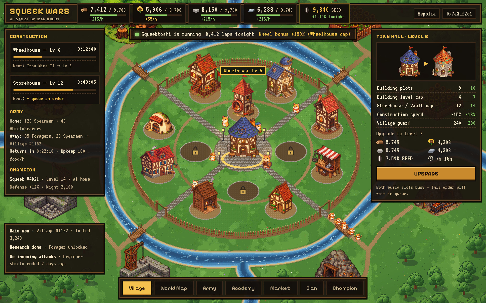
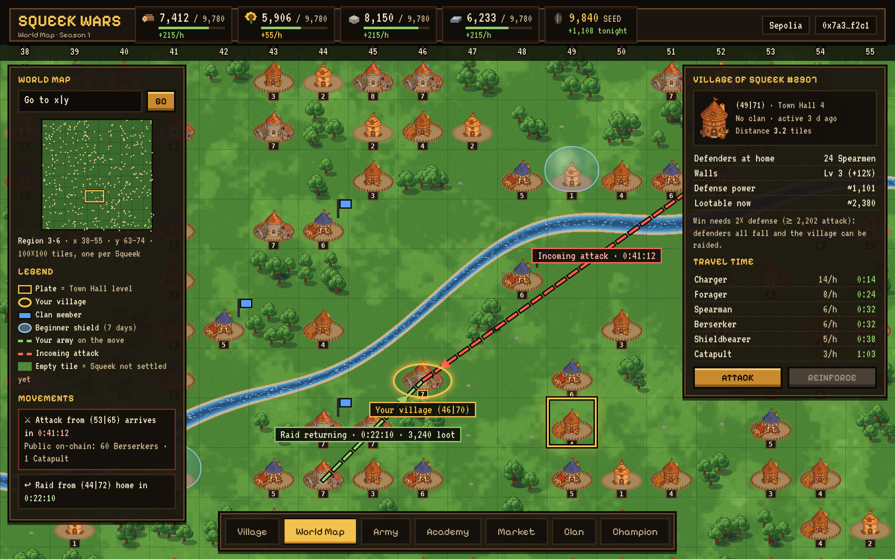

# Squeek Wars

A browser strategy game for [Squeekchain](https://squeekchain.com). Every wallet can found one village. Squeektoshi, the real hamster whose wheel runs drive Squeekchain, powers the economy: every village earns SEED from his settled work, and each night's run boosts production everywhere. Every village has a champion; holding Squeeks makes it a Squeek champion (+10% XP and stats) and speeds up construction. A practice season runs on the Sepolia testnet now; Mainnet Season 1 opens after the official Squeek mint.

**Play now:** [squeekwars.online](https://squeekwars.online) · Sepolia testnet, Season 2. The website is static and reads the chain directly; every action is a transaction the player signs. The five game contracts have [verified source](contracts/README.md#season-2-on-sepolia).

## The game in short

- **Build** a round village: Town Hall, 12 building plots, Walls, and 8 production sites (Wood, Food, Stone, Iron) across four river-split quarters.
- **Grow with the hamster:** SEED from Squeektoshi's runs pays for Town Hall upgrades and research, and the Wheelhouse turns his nightly runs into a production bonus of up to +250%, in every village.
- **Fight** on a 100 × 100 world map, one village per wallet: train seven unit types, scout, raid villages that are at least twice as weak, defend with Walls, Shieldbearers and your clan.
- **Champion and Squeeks:** every village has a champion that levels up from battles and the hamster's runs. Holding a Squeek makes it a Squeek champion (+10% XP and stats, golden glow), and Squeeks cut construction time after good runs (−15% with one, at most −30% however many you hold).
- **Wild camps:** about 200 camps on the map that never attack and grow gently over the season, so there is always something to raid while the player base grows. No bots: every village is a real wallet.
- **Fair by design:** one village per wallet, no player trading, SEED and resources never move between villages, no rarity caps, a beginner shield, raid limits and fully public on-chain state.

## How the game uses Squeekchain

- Once a day (04:00 UTC) anyone can press **Checkpoint**: `SeedLedger` reads the work counter of `SqueekCore` on chain and records the day's work for every village.
- **SEED:** every village claims the day's work ÷ 10 as SEED, spent on buildings, research, output boosts and peace shields.
- **Wheel bonus:** the Wheelhouse turns the same work into extra Wood, Food, Stone and Iron: work ÷ 4,320, capped at +25% per Wheelhouse level.
- **Champion XP:** every champion gains XP from the daily work.
- **Squeek NFT:** a Squeek holder's champion is a Squeek champion (+10% XP and stats), and Squeeks cut build time on busy days (−15% with one, at most −30%). Production and SEED are the same for everyone.

All of these numbers sit in the owner-editable rule table (`GameConfig`); every change is public on chain.

## Play the prototype

Open [`prototype/index.html`](prototype/) in a browser: the site plus a playable village, world map, scouting, raids, clans and a ranking, with time running 60× faster. See [prototype/README.md](prototype/README.md).

## Repository

| Path | What |
|---|---|
| [contracts/](contracts/) | Season 2 contracts (GameConfig, SeedLedger, Clans, Army, Villages), tests and tools |
| [site/](site/) | The live website: village, world map, army, academy, market, clans, ranking |
| [docs/GAME_DESIGN.md](docs/GAME_DESIGN.md) | Rules: economy, buildings, research, units, battle, champion, world map, protection, clans, ranking |
| [docs/SPEC.md](docs/SPEC.md) | Contract-level specification for the Season 1 build |
| [docs/IMD_BRIEF.md](docs/IMD_BRIEF.md) | The checked and quoted request for IMD's swarm |
| [docs/BUILDINGS.md](docs/BUILDINGS.md) | Every building level: effects, costs, times, looks |
| [docs/PLAYTEST.md](docs/PLAYTEST.md) | Playtest findings and what was fixed |
| `art/sprites/` | 74 cut-out sprites (buildings in 5 looks, units, champion, villagers, production sites) |
| `art/mockups/` | Village and world map screen mockups |
| `art/map/` | Village map concept |
| [art/PROMPTS.md](art/PROMPTS.md) | The prompts used to generate the art |
| `sim/` | Economy simulation (Python) and the parameters behind the tables |
| `prototype/` | Playable browser prototype (no wallet, no chain) |

## Status

Season 2 is live on Sepolia at [squeekwars.online](https://squeekwars.online). Mainnet Season 1 opens after the official Squeek mint.

squeekchain-project: 98396650-2a5e-43b6-931e-a7ae0b97affb
